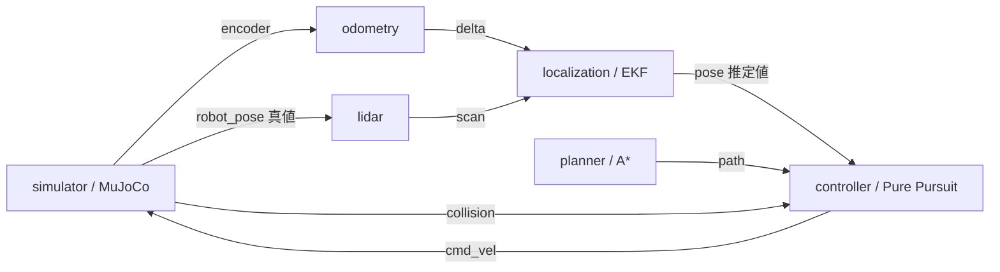

# 自律走行 Dataflow 設計

対応するフロー定義は [`dataflow.yml`](../dataflow.yml)。`./scripts/run-autonomous.sh` で起動する。テレオペは [`dataflow.teleop.yml`](../dataflow.teleop.yml) を使う。

## 対象

参照実装と同じ、既知の静的地図での開始地点から目標地点への走行を対象にする。経路は起動時に一度計算する。地図にない動的障害物の回避やオンライン再計画は、このフローの成功条件に含めない。

デモシナリオは [`configs/autonomous.toml`](../configs/autonomous.toml) の矩形障害物から占有グリッド、LiDAR のレイキャスト、MuJoCo の壁を作る。上下から交互に張り出す２つの障害物により、経路は上側から下側へ切り返す。参考ワークスペースの PGM/YAML 地図を直接読み込む実装ではない。

`simulator/robot_pose` は LiDAR の測定を合成するためだけに使う。`localization`、`planner`、`controller` には接続しない。真値姿勢は評価ログへ追加してよいが、走行判断には使わない。参考実装の線分対応付けの代わりに、現在の EKF は地図矩形への予測レンジと LiDAR の実測レンジを対応させる観測モデルを使う。

## ノードの責務

| ノード | 入力 | 出力 | 処理 |
| --- | --- | --- | --- |
| `simulator` | 100 Hz tick、`cmd_vel` | `encoder`、`robot_pose`、`collision` | MuJoCo を 10 ms 進め、車輪角度と真値姿勢を同じシミュレーションステップで発行する。接触時には自ら制動する。 |
| `odometry` | `encoder` | `delta` | 左右車輪角の差からロボット座標系の移動量と旋回量を計算する。真値姿勢は入力しない。 |
| `lidar` | `robot_pose`、5 Hz tick | `scan` | 最新の真値姿勢と静的地図からノイズ付きレンジを合成する。障害物点群や走行指令は出さない。 |
| `localization` | `delta`、`scan` | `pose` | 開始姿勢からオドメトリ予測を行い、LiDAR と地図で EKF 更新する。 |
| `planner` | 1 Hz tick | `path` | 設定された地図・開始姿勢・目標から A* の経路を起動時に計算し、同じ経路を再送する。 |
| `controller` | `pose`、`path`、`collision`、20 Hz tick | `cmd_vel`、`status` | 推定姿勢で経路を追従する。入力不足、陳腐化、接触、目標到達ではゼロ指令を出す。 |

`planner` の 1 Hz tick は、起動順による単発の経路メッセージ取りこぼしを避ける再送トリガーとする。地図・目標が変わらない限り再計算しない。`controller` は同じ `plan_id` の再送を状態リセットとして扱わない。

## メッセージ契約

座標は地図と MuJoCo で共通の右手系 XY 平面、角度は反時計回りの rad。距離は m、速度は m/s と rad/s。各サンプルの `step` は MuJoCo の 10 ms 更新ごとの単調増加整数で、Dora のメタデータに `Parameter::Integer` として入れる。`sim_time_ns` も同じメタデータに入れ、壁時計の受信時刻とは区別する。経路のような非センサーメッセージには `plan_id` を付ける。

| 出力 | Arrow データ | メタデータ・意味 |
| --- | --- | --- |
| `simulator/encoder` | `f64 × 2`: `[left_rad, right_rad]` | `step`, `sim_time_ns`。絶対車輪角。 |
| `simulator/robot_pose` | `f64 × 3`: `[x, y, yaw]` | `step`, `sim_time_ns`。センサー合成専用の真値。 |
| `simulator/collision` | `u8 × 1`: `[1]` | `step`, `sim_time_ns`。有効な接触を検知したら発行する。 |
| `odometry/delta` | `f64 × 3`: `[forward_m, lateral_m, delta_yaw_rad]` | 元の `encoder` と同じ `step`。差分が欠落した場合は推定を継続せず異常を報告する。 |
| `lidar/scan` | `f64 × N`: 各ビームの距離 | 測定に使った `robot_pose` の `step`, `sim_time_ns` と `min_angle`, `angle_increment`, `max_range`。無反射は `max_range` とする。 |
| `localization/pose` | `f64 × 3`: `[x, y, yaw]` | 推定が対応する `step`, `sim_time_ns`。 |
| `planner/path` | `f64 × 2N`: `[x0, y0, x1, y1, ...]` | `plan_id`, `goal_x`, `goal_y`, `goal_tolerance`。経路点はワールド座標。 |
| `controller/cmd_vel` | `f64 × 2`: `[linear_mps, angular_radps]` | 既存のテレオペと同じ契約。 |
| `controller/status` | `u8 × 1`: `1=running, 2=goal_reached, 3=failed` | 失敗時は `reason`。到達・失敗は確定状態として扱う。 |

メタデータの数値とデータ長を受信側で検査し、不正値や非有限値を走行指令に伝播させない。地図、ロボット外形、開始姿勢、目標、センサー設定は同じシナリオ設定から読み、地図と MuJoCo 障害物の一致を検証する。

## 周期と停止条件

- `simulator` と `odometry` は 100 Hz。LiDAR は 5 Hz。`controller` は 20 Hz で毎回指令を発行する。
- `encoder → odometry → localization` と `scan → localization` は順序と欠落検知を優先し、`backpressure` を使う。姿勢・真値・指令・タイマーは最新値を優先する。処理遅延が溜まった場合は走行を停止し、古いデータを再生して走り続けない。
- `localization` は `step` によってセンサーを整列する。遅れて届いたスキャンには、保持したオドメトリ履歴から該当ステップの EKF 状態を更新し、その後の差分を再適用する。履歴より古いスキャンは破棄する。スキャン待ちでオドメトリ処理をブロックしない。
- `controller` は経路または推定姿勢が未取得・陳腐化したとき、`collision` を受けたとき、到達したときにゼロ指令を出す。起動直後はゼロ指令のまま待機し、経路が 2 秒以上届かない場合は失敗とする。推定姿勢が 200 ms 以上古い場合は停止する。目標判定には推定姿勢を用いる。`simulator` の既存の 300 ms 指令タイムアウトも維持する。
- `odometry`、`lidar`、`localization` の入力が閉じた場合や LiDAR スキャンが一定時間更新されない場合は、`localization` が有効な姿勢を出し続けない。`controller` は停止指令と `failed` 状態を出す。待ち時間の判定には壁時計を使い、`step` と `sim_time_ns` は測定の整列に使う。

## 実装時の確認項目

1. `simulator/robot_pose` が `lidar` 以外の走行系ノードへ結線されていないこと。
2. 車輪の正転・逆転と `odometry/delta` の符号が一致すること。
3. 既知の壁までの `lidar/scan` 距離と地図座標が一致すること。
4. センサーの遅延・欠落・ノード停止で `cmd_vel` がゼロになること。
5. ヘッドレス E2E で衝突せず目標到達、停止、`goal_reached` の出力を確認できること。
